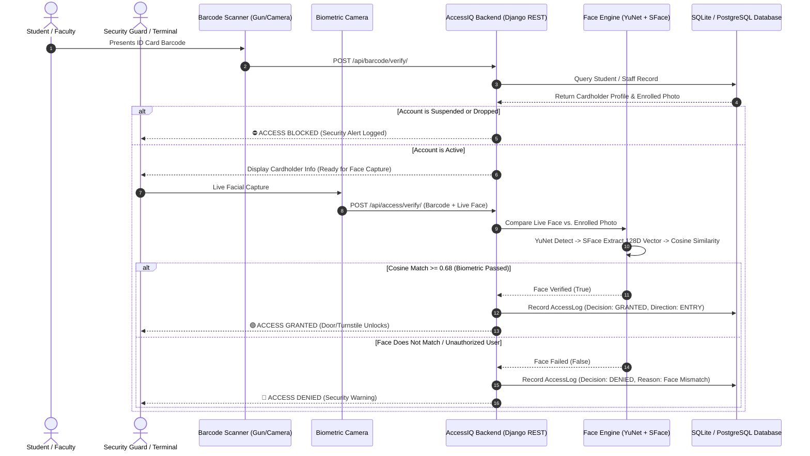

# Project Documentation: AccessIQ
## AI-Based Dual-Factor Campus Identity & Access Verification System

---

## 1. Executive Summary & Abstract

**AccessIQ** is a modern, high-throughput, dual-factor access control and student identification platform engineered specifically for educational institutions and campus perimeter security. 

Traditional campus security frameworks rely almost exclusively on single-factor physical tokens (RFID smart cards, barcode-printed plastic ID badges) or manual visual inspection by security guards. These legacy systems suffer from significant vulnerabilities:
* **Proxy and Impersonation:** Physical ID cards can be loaned, borrowed, cloned, or swapped among students.
* **Human Error and Bottlenecks:** Security guards during morning rush hours cannot reliably compare small badge photographs against incoming crowds.
* **Ineffective Paper-based Visitor Tracking:** Pen-and-paper registers offer zero identity verification, lack auditability, and create security blind spots.

**AccessIQ** eliminates proxy entries and credential sharing by introducing **real-time 1-to-1 Dual-Factor Authentication (2FA)** at campus checkpoints:
1. **Factor 1 (Possession - "What you have"):** Physical Student or Faculty ID Card (scanned via Code128 Barcode, QR code, or USB barcode gun scanner).
2. **Factor 2 (Inherence - "Who you are"):** High-speed edge AI facial recognition utilizing deep neural networks (**OpenCV YuNet** for face detection and **SFace** for feature embedding extraction and cosine similarity matching).

Access is **strictly granted** only when both factors match with high confidence ($\ge 68\%$ similarity) and the student's status is verified as active.

---

## 2. Problem Statement & Comparison

| Parameter | Traditional Campus Gate Security | AccessIQ Dual-Factor System |
| :--- | :--- | :--- |
| **Authentication Factor** | Single-factor (Card only or Guard eye check) | **Dual-Factor** (Card token + Live AI Facial Biometrics) |
| **Proxy Prevention** | ❌ None (Anyone holding the card can enter) | ✅ **100% Prevented** (Cardholder's face must match live) |
| **Verification Speed** | ⏱️ 5 to 15 seconds per student manually | ⚡ **Under 1 second** ($\approx 20\text{ms}$ AI inference) |
| **Visitor Management** | 📝 Paper logbooks with fake names/numbers | 📱 Digital Visitor Pass system with photo & checkout logs |
| **Security Blacklists** | ❌ Guards rarely remember suspended IDs | 🚨 Instant audible and visual security alert for suspended/blocked IDs |
| **Audit Logs** | ❌ Lost or incomplete paper records | 📊 Complete historical timestamped logs with CSV exports |

---

## 3. System Architecture & Dual-Factor Workflow



---

## 4. Key Technical Innovations

### 4.1. 1-to-1 Verification vs. 1-to-N Crowd Scanning
* **The Flaw of 1-to-N (Crowd) Recognition:** When an AI camera attempts to scan a person against a database of 10,000 students simultaneously, computation is extremely slow ($O(N)$), false positives spike dramatically, and expensive multi-GPU servers are required.
* **AccessIQ's 1-to-1 Architecture:** 
  1. The student scans their barcode first. This instantly identifies the exact record ($O(1)$ database lookup).
  2. The AI only compares the live face against **one enrolled profile**.
  3. This guarantees near-zero false positive rates, takes **less than 25 milliseconds on standard CPU hardware**, and requires no costly cloud API subscriptions.

### 4.2. Edge AI Biometric Pipeline (OpenCV YuNet + SFace)
* **Face Detection (YuNet):**
  * A lightweight deep convolutional neural network optimized for fast inference on edge devices and CPUs.
  * Detects facial bounding boxes and 5 key facial landmarks (two eyes, nose tip, two mouth corners) even under poor campus lighting and varying angles.
* **Feature Extraction & Verification (SFace):**
  * Transforms the cropped, aligned face into a **128-dimensional hyperspherical embedding vector**.
  * Measures the cosine similarity between the enrolled face embedding and the live capture:
    $$\text{Similarity}(A, B) = \frac{A \cdot B}{\|A\|_2 \|B\|_2}$$
  * A calibrated threshold of **0.68 (68%)** provides optimal defense against impostors while ensuring frictionless access for legitimate cardholders.

### 4.3. Account Status & Blocked Card Enforcement
* Directly built into the API layer (`backend/security/bouncer_api.py`):
  * Active student/staff profiles proceed to biometric verification.
  * If a card belongs to a student who has been **Suspended**, **Dropped**, or **Blacklisted**, the gate station instantly rejects the entry and automatically logs a high-severity `SecurityAlert` notifying campus administration.

---

## 5. System Modules & Interface Overview

### 5.1. Access Verification Terminal (`/terminal/`)
* **Target Environment:** Dedicated gate checkpoint computers, turnstiles, and campus kiosks.
* **Features:**
  * Auto-listening integration for hardware **USB Gun Barcode Scanners**.
  * Embedded camera scanning overlay with reticle and auto-decode capabilities.
  * Real-time live camera viewport with mirror flip and one-click capture.
  * Visual decision cards showing verified badge indicators (`Barcode: OK`, `Face Match: OK`).

### 5.2. Bouncer Guard Mobile Station (`/bouncer/`)
* **Target Environment:** Security guard smartphones and handheld tablets at campus gates.
* **Features:**
  * Touch-optimized interface designed for fast gate throughput.
  * Quick scan and live front/rear camera selfie capture.
  * Instant access grant/deny visual indicators.
  * Quick visitor pass issuing and on-the-spot operational issue reporting.

### 5.3. Administrative & Security Management Center (`/`)
* **Target Environment:** Chief Security Officer, Registrar, and IT Administration desks.
* **Features:**
  * Real-time statistics: Total campus entries, denied access attempts, active visitors on site.
  * **Card Enrollment Engine:** Register students and staff, upload reference photos, and auto-generate scannable Code128 barcodes.
  * **Visitor Management:** Register guests, issue digital passes, track active visitors inside campus, and check them out upon exit.
  * **Audit & Reports:** Filter access logs and export compliance audit reports directly to CSV.

### 5.4. React Native Mobile App (Expo)
* Cross-platform mobile application supporting mobile guards.
* Directly communicates with the central Django backend via REST APIs over Wi-Fi LAN.

---

## 6. Technology Stack

| Domain | Technology | Purpose |
| :--- | :--- | :--- |
| **Backend Framework** | Python 3.11+, Django 4.2+ | Robust ORM, enterprise security, and authentication |
| **RESTful API** | Django REST Framework (DRF) | Clean endpoints for web clients, terminals, and mobile apps |
| **Computer Vision / AI** | OpenCV (YuNet + SFace ONNX models) | Lightweight, sub-second face detection and recognition on CPU |
| **Frontend Web** | HTML5, Bootstrap 5, Vanilla JavaScript | Responsive, stateful user interfaces without heavy frontend frameworks |
| **Barcode Generation** | JsBarcode | Dynamic client-side Code128 barcode rendering |
| **Mobile App** | React Native, Expo SDK 52, TypeScript | Handheld guard scanner application |
| **Database** | SQLite (Development) / PostgreSQL (Production) | Relational student, staff, visitor, and access audit storage |

---

## 7. Database Entity Model (Key Schemas)

1. **Student / Staff Profile (`identity` app):**
   * `student_id` / `staff_id` (Unique barcode token)
   * `full_name`, `department`, `course`, `semester`
   * `photo` (Enrolled reference image)
   * `status` (`ACTIVE`, `SUSPENDED`, `ALUMNI`, `DROPPED`)
2. **Face Profile (`face_engine` app):**
   * One-to-one foreign key to student/staff
   * `embedding_vector` (128-dimensional floating point representation)
   * `registered_photo`
3. **Access Location (`access_control` app):**
   * `name` (e.g., College Main Gate)
   * `code` (`GATE-MAIN`)
   * `is_active`
4. **Access Log (`access_control` app):**
   * `student` / `staff` reference
   * `location`, `timestamp`, `direction` (`ENTRY` / `EXIT`)
   * `barcode_verified` (Boolean), `face_verified` (Boolean)
   * `final_decision` (`GRANTED` / `DENIED`)
   * `failure_reason` (e.g., "Face Biometrics Mismatched")
5. **Visitor & Visitor Pass (`visitors` app):**
   * `full_name`, `phone_number`, `purpose`, `host_person`
   * `pass_code` (Unique scannable visitor barcode)
   * `check_in_time`, `check_out_time`, `is_active`

---

## 8. Deployment & Running Guide

### 8.1. Starting the Backend Server
```powershell
# Activate virtual environment
.\venv\Scripts\activate

# Apply migrations
python backend/manage.py migrate

# Run server on all network interfaces (Accessible by PCs and phones)
python backend/manage.py runserver 0.0.0.0:8000
```

### 8.2. Accessing on Local PC
* **Access Terminal:** `http://localhost:8000/terminal/`
* **Bouncer Station:** `http://localhost:8000/bouncer/`
* **Admin Dashboard:** `http://localhost:8000/`

### 8.3. Accessing on Smartphones over Local Wi-Fi
1. Connect smartphone to the same Wi-Fi router.
2. Obtain computer Wi-Fi IP address via `ipconfig` (e.g., `192.168.0.104`).
3. Open mobile browser to `http://192.168.0.104:8000/terminal/` or `http://192.168.0.104:8000/bouncer/`.
4. *Chrome Camera Permission Tip:* In mobile Chrome, enable `chrome://flags/#unsafely-treat-insecure-origin-as-secure`, add `http://192.168.0.104:8000`, and relaunch.

---

## 9. Viva / Defense Q&A Cheat Sheet

**Q1: Why dual-factor authentication rather than just RFID cards or just Face Recognition?**
> *Answer:* RFID cards alone cannot prove who is carrying them (high risk of proxy/lending). Pure facial recognition in a crowd (1-to-N search) is slow and prone to false identifications. Combining the two results in a fast, robust 1-to-1 biometric comparison that is computationally efficient and virtually impossible to cheat.

**Q2: What machine learning models are used and why?**
> *Answer:* We use OpenCV's deep learning modules: YuNet for face detection and SFace for facial recognition. They are ONNX-based lightweight neural networks designed to run on CPUs in real-time (~20ms per face), eliminating the need for expensive GPU servers or cloud API bills.

**Q3: How does the system handle security risks like suspended students or fake IDs?**
> *Answer:* When any barcode is entered or scanned, the system immediately checks the cardholder's status. If an ID has been marked as suspended or dropped, the gate station instantly denies entry and triggers an automated security alert in the audit log.

**Q4: Can this system scale to thousands of students?**
> *Answer:* Yes. Because it uses 1-to-1 verification, the verification latency remains constant ($\approx 25\text{ms}$) regardless of whether the college has 100 students or 50,000 students.
