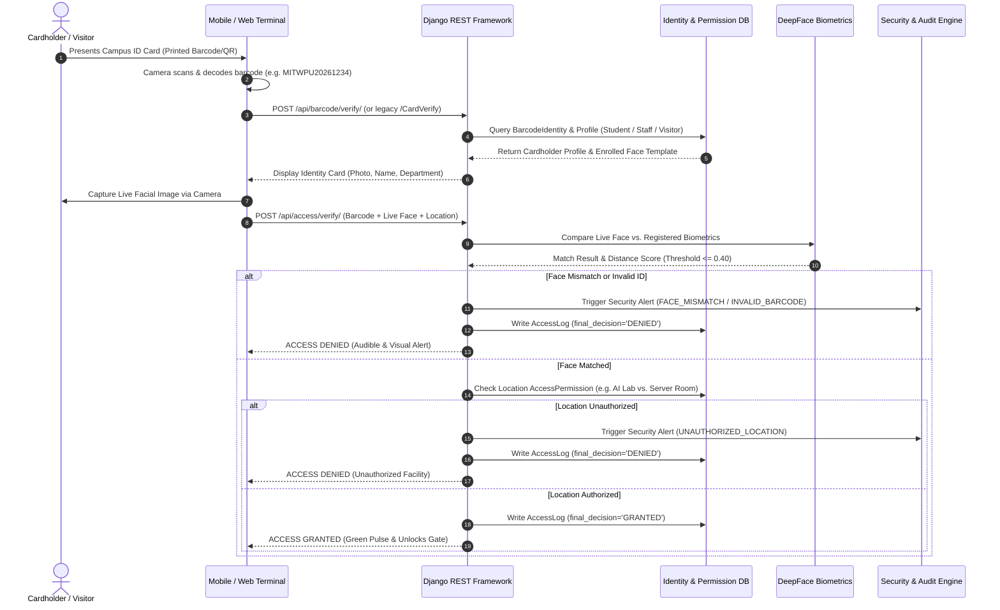

# AccessIQ: Smart Campus Identity, Access & Security Management System

> **A Dual-Factor Campus Security, Identity Verification, and Access Management Architecture**  
> Extended and transformed from *RFID-AI-Based-Student-Identification* into an institutional-grade access management platform.

---

## 1. Executive Summary

**AccessIQ** is a next-generation smart campus identity, access, and security management platform designed for universities, research institutes, and educational campuses. The system transitions identity verification away from vulnerable single-factor methods and legacy RFID dependencies into an intelligent, dual-factor authentication paradigm:

$$\text{Authorized Access} = \text{Verified Barcode/QR ID} + \text{Live Face Biometrics} + \text{Location Access Permission}$$

### Strict Operational Scope
* **Scope**: Campus perimeter security, research lab access, computer lab entry, visitor access passes, campus equipment loans, real-time security alerts, and administrative audit trails.
* **Non-Scope**: AccessIQ is **strictly an Access & Security Management System**. It explicitly does **NOT** manage academic examinations, course attendance, grades, marks, student academic evaluations, or disciplinary penalties.

---

## 2. Hardware Evolution: Transition from RFID to Barcode/QR Scanning

| Parameter | Legacy System | AccessIQ Implementation |
| :--- | :--- | :--- |
| **Primary Identifier** | Physical RFID Card Reader (Hardware Required) | **Printed Barcode / QR Code** on standard student ID cards |
| **Scanner Hardware** | Dedicated RFID hardware reader | **Mobile Camera / Web Camera** (No extra reader hardware needed) |
| **Identity Lookup** | Simulated RFID Card UID | **Scanned Barcode Value** (e.g. `MITWPU20261234`) resolved via REST API |
| **Biometric Verification** | Standalone image comparison | **Dual-Factor Engine**: Cardholder Face Biometrics + Location Permission Rule |
| **RFID / NFC Status** | Mandatory in original codebase | **Preserved as Future Scope / Optional Add-on** |

---

## 3. Core Architecture & Technology Stack

* **Backend Framework**: Django 6.0 + Django REST Framework (DRF)
* **Database**: PostgreSQL (Production-ready via `.env`, with automatic SQLite development fallback)
* **Computer Vision & Biometrics**: OpenCV + DeepFace (VGG-Face / Cosine Distance) with resilient fallback
* **Mobile Client**: React Native with TypeScript / JavaScript, `react-native-animatable`, `@react-native-async-storage/async-storage`
* **Web Dashboard**: Responsive Django Templates + Bootstrap 5 + Chart.js Analytics
* **Reports Engine**: Multi-format export in CSV, Excel (`openpyxl`), and PDF (`reportlab`)
* **Security & Auditing**: Django Authentication, Role-Based Access Control (RBAC), Device Enrollment, Immutable Audit Logs

---

## 4. The 10-Step AccessIQ Dual-Authentication Flow



---

## 5. Domain Modules & Features

### A. Authorized Device Management (Evolved from Device Registration)
* Manages security handhelds, gate terminals, and tablet scanners.
* Device credentials (IMEI/UUID + Security PIN) stored securely with `AsyncStorage`.
* Backend tracks device status (`Active`/`Deactivated`) and `last_active_at` heartbeat.

### B. Identity & Biometrics Management
* **Student Profiles**: Student ID, Name, Department, Course, Semester, Contact & Parent Mobile, Status (`Active`, `Alumni`, `Suspended`).
* **Staff Profiles**: Staff ID, Name, Department, Designation, Contact.
* **Barcode Identities**: Maps physical Code128 / QR codes to registered users.
* **Face Profiles**: Reference face templates and enrollment statuses (`ENROLLED`, `PENDING`, `REJECTED`).

### C. Campus Locations & Permission Rules
* Secured facilities: AI/ML Lab (`LAB-AIML`), Computer Lab 1 (`LAB-COMP1`), Central Library (`LIB-MAIN`), Server Room (`ROOM-SRV`), Innovation Hub (`ROOM-INNOV`), Equipment Room (`ROOM-EQUIP`).
* Granular permission rules per user or role with optional time/weekday restrictions.

### D. Visitor Management & Temporary Passes
* Guest registration with host details, purpose, photo, and check-in/out tracking.
* Time-bound digital QR passes (e.g. `PASS-QR-98214`) with automatic expiration enforcement.

### E. Campus Equipment & IoT Asset Tracking
* Inventory management for lab hardware: Laptops, 4K Vision Cameras, Raspberry Pi 4 kits, Arduino IoT sets, and Jetson AI kits.
* Loan checkout tracking with borrower identity, expected return date, and condition notes.

### F. Security Alerts & Compliance Audit Trail
* Automated alerts for: `INVALID_BARCODE`, `UNKNOWN_ID`, `BLOCKED_ID`, `FACE_MISMATCH`, `EXPIRED_PASS`, `UNAUTHORIZED_LOCATION`, `MULTIPLE_FAILURES`.
* Immutable administrative audit trail recording operator actions, timestamps, and IP addresses.

### G. Analytics Command Center & Reports Center
* 4 Real-time Chart.js graphs: 7-Day Access Trends, Location Traffic Breakdown, Authentication Outcome Ratio, and Alert Type Distribution.
* Export engines for Access Logs, Security Incidents, and Equipment in **CSV**, **Excel (.xlsx)**, and **PDF**.

---

## 6. REST API Reference

### Modern RESTful APIs

| Method | Endpoint | Description |
| :--- | :--- | :--- |
| `POST` | `/api/auth/login/` | Authenticate security staff / administrator |
| `POST` | `/api/auth/devices/register/` | Register or authorize a verification terminal |
| `GET` | `/api/auth/devices/` | List all authorized terminals and heartbeats |
| `POST` | `/api/barcode/verify/` | Resolve scanned Barcode/QR ID to cardholder identity |
| `POST` | `/api/face/verify/` | DeepFace / OpenCV facial comparison between two images |
| `POST` | `/api/face/enroll/` | Register live face image as cardholder reference template |
| `POST` | `/api/access/verify/` | **Core Dual-Factor Access Verification** |
| `GET` | `/api/access/locations/` | List secured campus facilities and security tiers |
| `GET` | `/api/access/logs/` | Query real-time access audit logs |
| `GET` | `/api/visitors/` | List registered campus visitors |
| `POST` | `/api/visitors/<id>/approve/` | Approve visitor and auto-generate Temporary QR Pass |
| `GET` | `/api/temporary-passes/` | List active and expired temporary access passes |
| `GET` | `/api/equipment/` | Campus hardware inventory list |
| `POST` | `/api/equipment/transactions/` | Issue equipment loan to student or staff |
| `GET` | `/api/security/alerts/` | Security alerts feed |
| `GET` | `/api/analytics/dashboard-stats/`| Real-time aggregated statistics for dashboards |
| `GET` | `/api/reports/access/pdf/` | Download official Access Logs audit report as PDF |
| `GET` | `/api/reports/access/excel/` | Download Access Logs spreadsheet (.xlsx) |
| `GET` | `/api/reports/access/csv/` | Download Access Logs as CSV |

### Legacy Backward-Compatibility Routes
The following endpoints preserve 100% drop-in compatibility for existing clients:
* `POST /verify` $\rightarrow$ Maps to DeepFace verification
* `GET /CardVerify?sIdentificationNo=...&sPinNo=...&lCardNo=...` $\rightarrow$ Maps to cardholder lookup
* `POST /DeviceRegestration` $\rightarrow$ Maps to authorized device registration

---

## 7. Setup & Execution Guide

### Prerequisites
* Python 3.10+ (Tested on Python 3.13)
* Node.js v18+ (Tested on v24)
* PostgreSQL (Optional; defaults to zero-config SQLite out of the box)

### Step 1: Install Python Dependencies
```bash
pip install -r requirements.txt
```

### Step 2: Configure Environment Variables
Copy `.env.example` to `backend/.env`:
```bash
cp backend/.env.example backend/.env
```
*(To use PostgreSQL, set `USE_POSTGRESQL=True` and configure your database credentials).*

### Step 3: Run Database Migrations & Seed Demo Data
```bash
cd backend
python manage.py migrate
python manage.py seed_accessiq_data
```
*Creates initial administrator (`admin` / `admin123`), campus locations, students (Hetvi Patel `MITWPU20261234`), faculty (`STAFF-202601`), equipment, and demo logs.*

### Step 4: Run the Backend Server
```bash
python manage.py runserver 0.0.0.0:8000
```
Open your browser at:
* **Command Center Dashboard**: [http://127.0.0.1:8000/](http://127.0.0.1:8000/)
* **Live Access Terminal**: [http://127.0.0.1:8000/terminal/](http://127.0.0.1:8000/terminal/)
* **Reports Center**: [http://127.0.0.1:8000/reports/](http://127.0.0.1:8000/reports/)
* **Django Admin**: [http://127.0.0.1:8000/admin/](http://127.0.0.1:8000/admin/)

### Step 5: Run the Automated Test Suite
```bash
python manage.py test access_control
```

### Step 6: Start the React Native Mobile Client
From the repository root:
```bash
npm install
npm start
```
*(In the mobile app Settings tab, point the server URL to your machine's local IPv4 address, e.g. `http://192.168.x.x:8000` or `http://10.0.2.2:8000` for Android emulator).*

---

## 8. Privacy, Biometrics Ethics & Institutional Security

1. **Biometric Data Protection**: Biometric face templates are stored securely in protected storage directories and never leaked through unauthenticated public APIs.
2. **Access Control Only**: AccessIQ strictly maintains access audit logs. It does not monitor personal student academic data.
3. **Institutional Deployment Consent**: In real-world university deployment, facial enrollment requires informed student/staff consent in compliance with institutional data governance policies.
